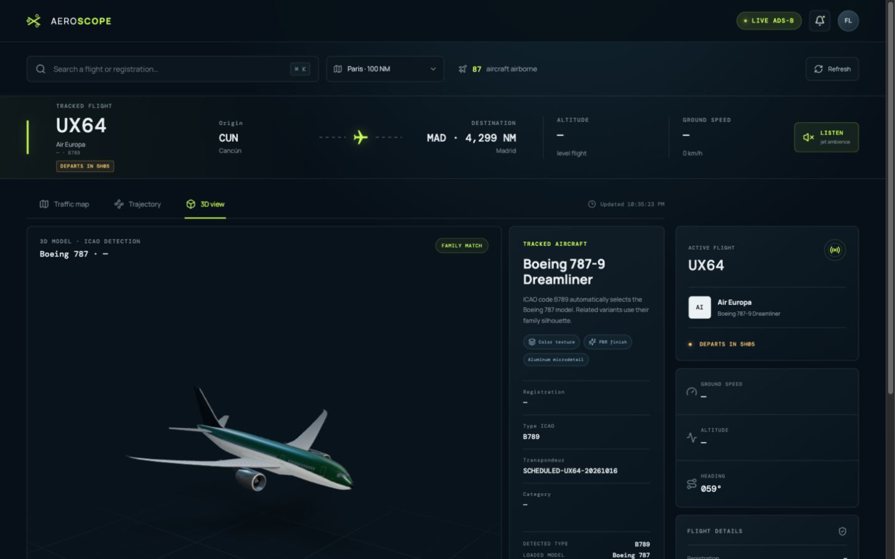
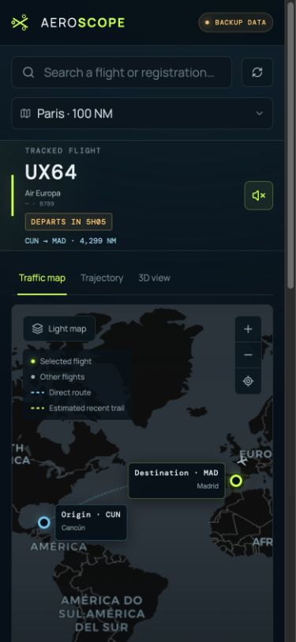

# AeroScope

<p align="center">
  <strong>Suivi de vols ADS-B, trajectoires et avions 3D dans une interface pensée pour le web et le mobile.</strong>
</p>

<p align="center">
  <a href="https://flight.guilleme.net/">Voir la version en ligne</a>
  ·
  <a href="#installation-locale">Installation</a>
  ·
  <a href="#sources-et-licences">Sources</a>
</p>

AeroScope est un tableau de bord aéronautique responsive construit avec React,
MapLibre et Three.js. Il affiche le trafic réel d'une zone, retrouve un vol par
son numéro ou son indicatif, trace sa route et charge automatiquement une
maquette 3D adaptée au type ICAO de l'appareil.

## Aperçu

### Carte et trajectoire complète


<table>
  <tr>
    <th width="68%">Modèle 3D interactif</th>
    <th width="32%">Interface mobile</th>
  </tr>
  <tr>
    <td></td>
    <td></td>
  </tr>
</table>

## Fonctionnalités

- trafic aérien ADS-B actualisé toutes les 20 secondes ;
- recherche par numéro de vol, indicatif, immatriculation, type ou compagnie ;
- sélection d'une zone prédéfinie ou centrage sur la position GPS ;
- route directe entre les aéroports d'origine et de destination ;
- recadrage automatique pour conserver toute la trajectoire visible ;
- désencombrement dynamique des avions selon le niveau de zoom ;
- distance restante et durées totale/restante estimées ;
- états localisés : départ programmé, vol en cours et atterrissage ;
- visualisation 3D orbitable et zoomable avec modèle choisi par type ICAO ;
- matériaux PBR, textures et microrelief sur les maquettes compatibles ;
- ambiance sonore de réacteur générée avec la Web Audio API ;
- interface française ou anglaise selon la langue du navigateur ;
- mise en page adaptée aux ordinateurs, tablettes et téléphones.

Lorsque le flux temps réel n'est pas disponible, l'en-tête indique clairement
`DONNÉES DE SECOURS`. L'application réessaie ensuite automatiquement de joindre
la source ADS-B.

## Stack technique

| Domaine | Technologie |
| --- | --- |
| Interface | React 19, TypeScript, Vite |
| Carte | MapLibre GL, CARTO, OpenStreetMap |
| 3D | Three.js, React Three Fiber, Drei |
| Icônes | Lucide React |
| Trafic | API communautaire adsb.lol |
| Routes | API ADSBDB |
| Production | Caddy, fichiers statiques compressés |

## Architecture des données

```text
Navigateur
   ├── /api/aircraft/* ── proxy Vite/Caddy ──► adsb.lol
   ├── /api/route/*    ── proxy Vite/Caddy ──► ADSBDB
   ├── fond de carte   ──────────────────────► CARTO / OpenStreetMap
   └── modèles 3D     ──────────────────────► fichiers GLB locaux
```

Les proxys évitent les problèmes CORS et gardent les adresses des fournisseurs
hors du code des composants. Aucune clé d'API n'est nécessaire pour les sources
actuellement utilisées.

## Installation locale

### Prérequis

- Node.js 20.19 ou plus récent ;
- npm ;
- une connexion internet pour les données aériennes et le fond de carte.

```bash
git clone <url-du-depot>
cd Flight
npm install
npm run dev
```

Vite affiche ensuite l'adresse locale, généralement
[`http://localhost:5173`](http://localhost:5173).

### Commandes disponibles

```bash
npm run dev      # serveur de développement avec proxys API
npm run build    # vérification TypeScript et build de production
npm run preview  # aperçu local du build avec les mêmes proxys
```

## Déploiement

Le build de production est généré dans `dist/` :

```bash
npm run build
```

Le fichier [`deploy/Caddyfile`](deploy/Caddyfile) contient la configuration de
référence utilisée par le site public. Elle sert l'application statique, renvoie
les routes inconnues vers `index.html` et relaie les deux API :

- `/api/aircraft/*` vers `https://api.adsb.lol` ;
- `/api/route/*` vers `https://api.adsbdb.com`.

Pour un autre domaine ou un autre répertoire de publication, adaptez le bloc
`flight.guilleme.net` et sa directive `root`.

## Organisation du projet

```text
src/
├── components/       # carte, trajectoire, panneau de détails et scène 3D
├── hooks/            # données ADS-B, routes et moteur audio
├── aircraftModels.ts # correspondance type ICAO → maquette GLB
├── data.ts           # zones et données de secours
├── i18n.tsx          # traductions française et anglaise
├── styles.css        # interface responsive
└── utils.ts          # distances, durées, caps et géométrie de route

public/models/        # modèles 3D et notices de licence
deploy/Caddyfile      # configuration de production
```

## Limites connues

- La couverture dépend des récepteurs communautaires ADS-B disponibles.
- Certains vols militaires, privés ou hors couverture n'exposent pas toutes
  leurs informations.
- Une trajectoire affichée est une route directe indicative, pas le plan de vol
  ATC détaillé.
- Les durées sont calculées à partir des horaires connus ou estimées selon la
  distance et la famille d'appareil.
- Un modèle générique est utilisé lorsqu'aucune maquette dédiée ne correspond au
  code ICAO reçu.

## Sources et licences

- Trafic aérien : [adsb.lol](https://adsb.lol), données ODbL 1.0.
- Informations de route : [ADSBDB](https://www.adsbdb.com/).
- Fond de carte : [OpenStreetMap](https://www.openstreetmap.org/) et
  [CARTO](https://carto.com/).
- A320, A350, A380, B737 et B787 :
  [amvlab/aircraft-models](https://github.com/amvlab/aircraft-models), CC BY 4.0.
- Modèles FlightGear complémentaires :
  [Flightradar24/fr24-3d-models](https://github.com/Flightradar24/fr24-3d-models),
  GPL v2.
- Silhouettes complémentaires :
  [FlightAirMap-3dmodels](https://github.com/Ysurac/FlightAirMap-3dmodels), GPL v2.
- Modèle générique « Regional jet aircraft » : Innerscene, CC0 1.0.

Les textes complets et les attributions associées aux modèles sont conservés
dans [`public/models`](public/models/).

## Confidentialité

La géolocalisation n'est demandée que lorsque l'utilisateur choisit explicitement
« Ma position ». Elle sert uniquement à définir la zone de recherche dans le
navigateur et n'est pas stockée par AeroScope.
